# PrivateBot · 个人 AI 工作台

**源码公开，仅限非商用**（[PolyForm Noncommercial 1.0.0](LICENSE)）。自己部署自己用、学习研究、个人项目都可以；卖它、放进收费产品、在公司里当工具用不行，要商用请先联系（见 §11）。

> 遇到问题先运行 `npm run diagnose`，把输出贴进 Issue。常见问题见 [docs/FAQ.md](docs/FAQ.md)。

一个跑在你自己电脑上的 **AI 控制面**：你把活派出去，Claude Code、Codex、DeepSeek、WorkBuddy 这些 AI 在你的电脑上并行干；**危险的事停下来等你在网页或手机上点一下**；花了多少额度、谁干得好、哪里在等你，一层一层看得清。

**它做决定，不动手干活。** 干活的是各家 AI 工具（执行器里）；工作台管派给谁、批不批、提醒什么、数据怎么样——每个决定都有规则先筛、你能推翻、留审计。

- **多家 AI 一起用**：不绑死一家。调度大脑按战绩、擅长和剩余额度挑人；同一家的多个账号用满自动换下一个。
- **人始终握着刹车**：命中规则的操作停下来等你；合并、推送、部署永远要人点。
- **沙箱**：可选让任务在一次性容器里跑——没有出口的网络、白名单代理、真密钥不进容器、代码改动以补丁出来、检查过才进你的仓库（§4.1）。
- **全在自己手里**：自己的电脑、自己的账号、自己的数据。工作台不保存任何模型密钥。
- **零依赖**：只用 Node 22 自带的 HTTP 服务和 SQLite，没有 `npm install`，没有构建步骤；数据是一个 SQLite 文件。
- **界面一层打开一层**：第一层一句话 + 几行，点开才是细节；墨色加一个黄绿色，只靠深浅分轻重。

以下截图使用独立演示数据库。

| 视图 | 浅色 | 深色 |
|---|---|---|
| 工作台 | 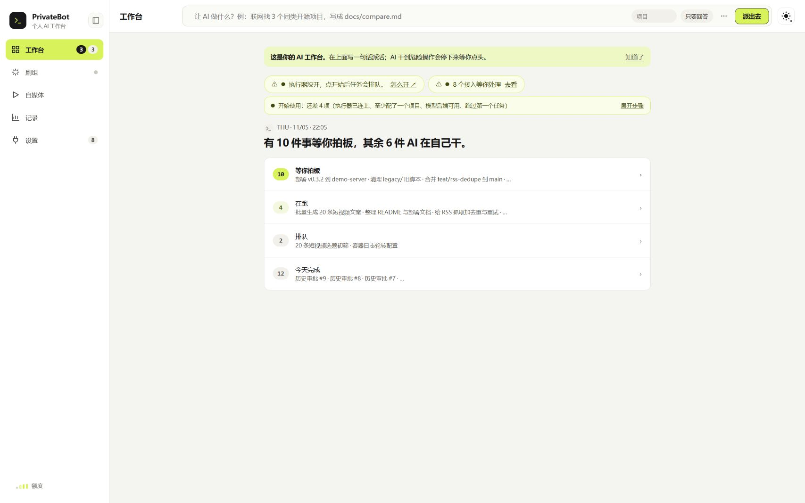 | 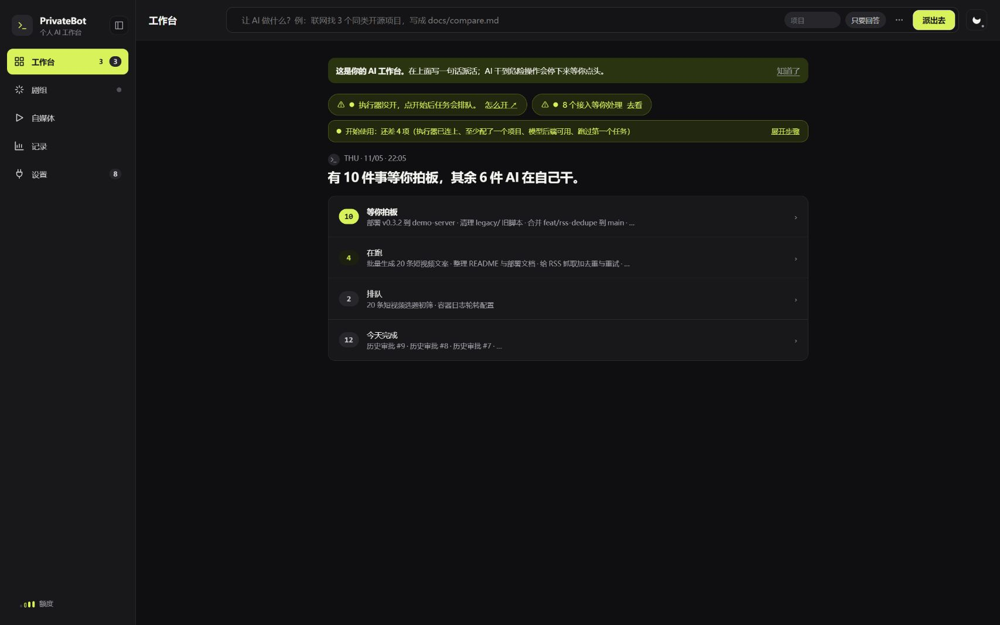 |
| 右侧详情 | 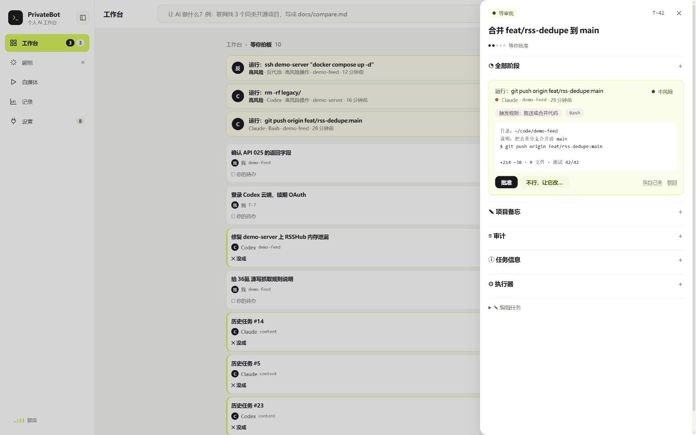 | 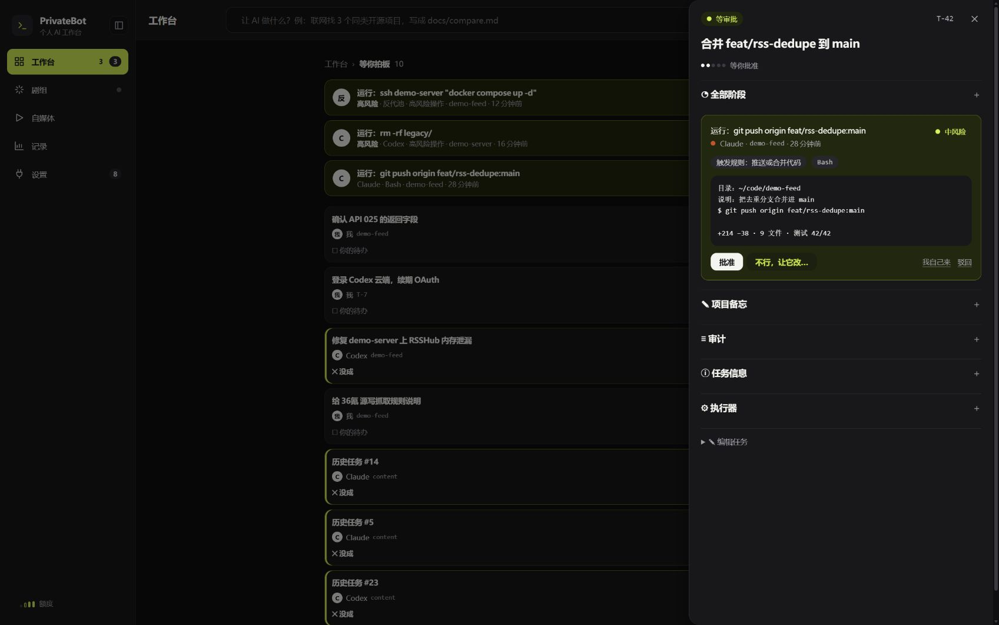 |
| 剧组 | 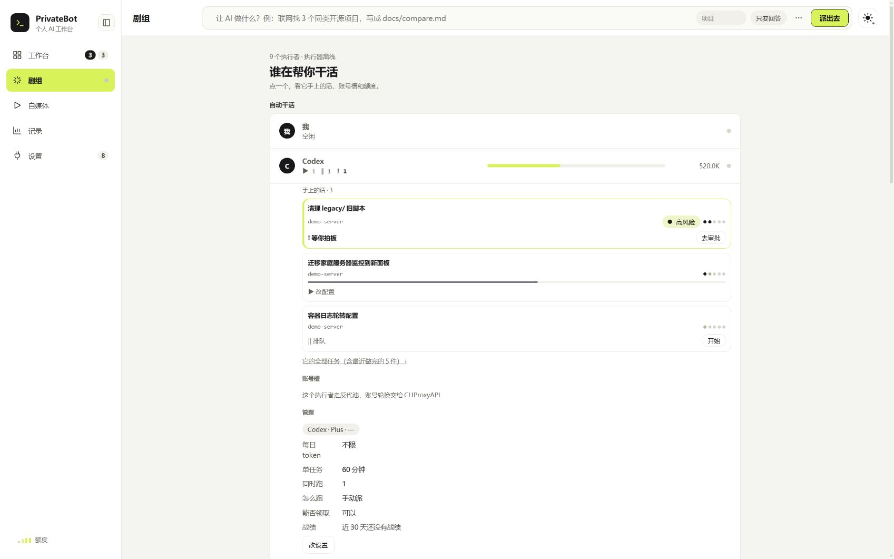 | 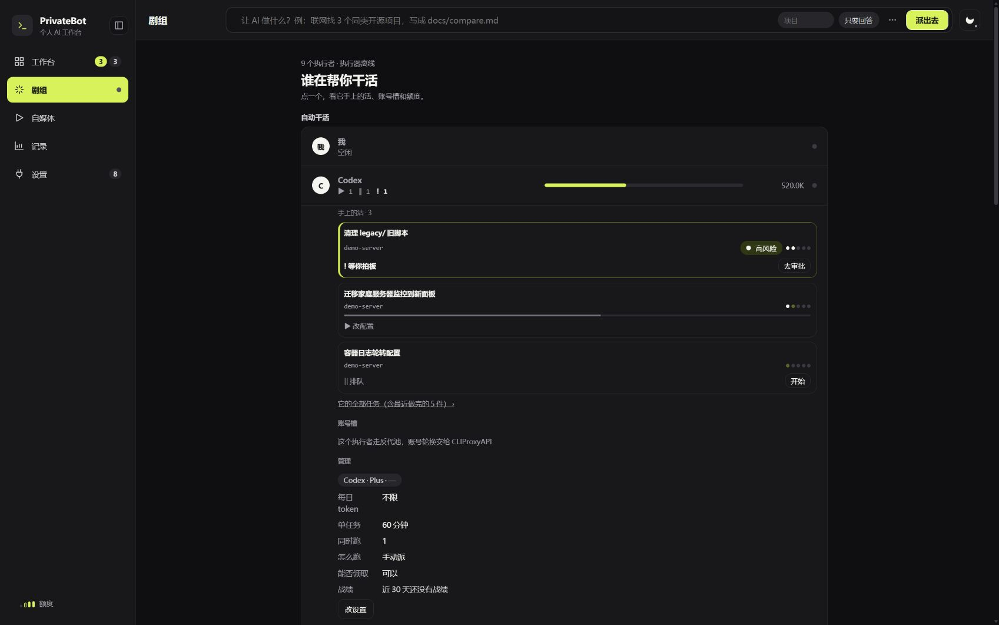 |
| 自媒体 | 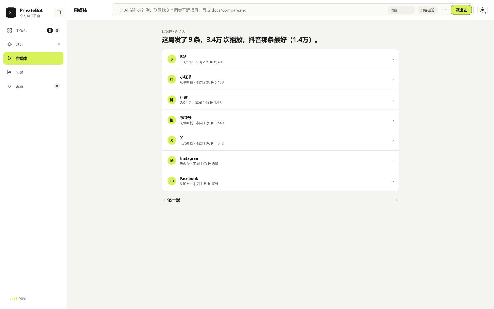 | 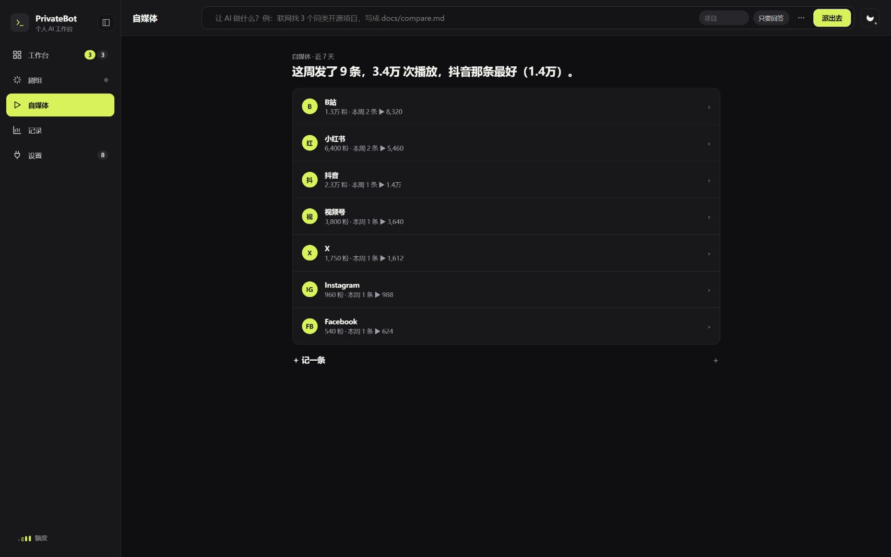 |
| 记录 | 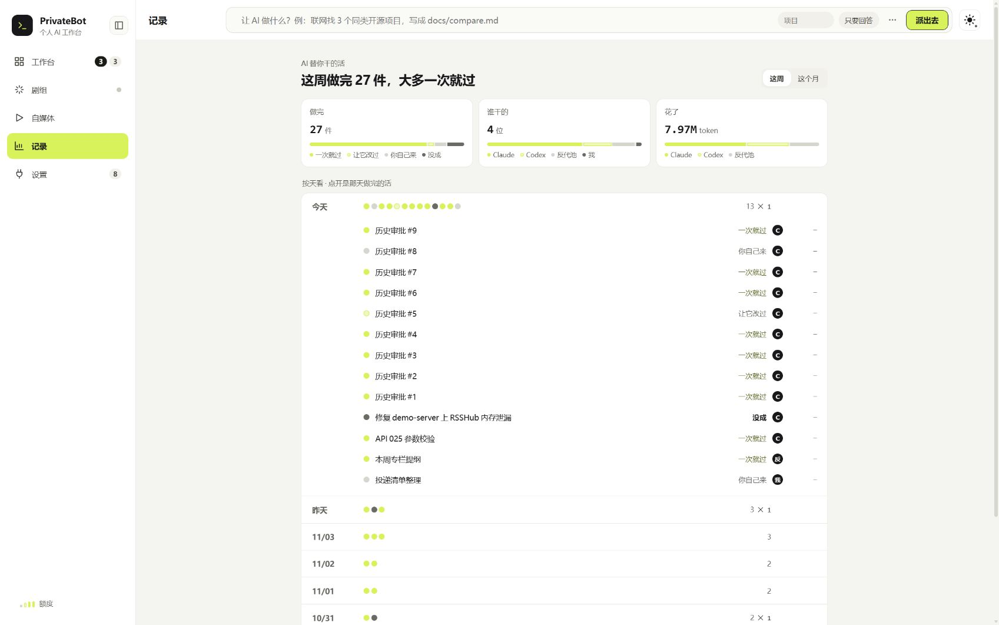 | 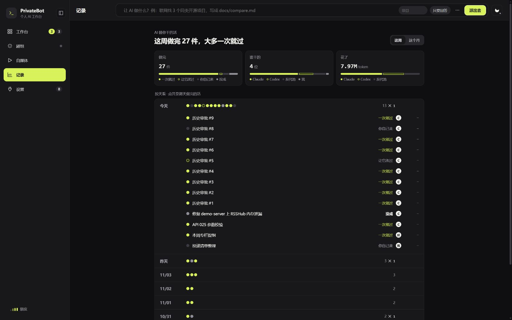 |
| 设置 | 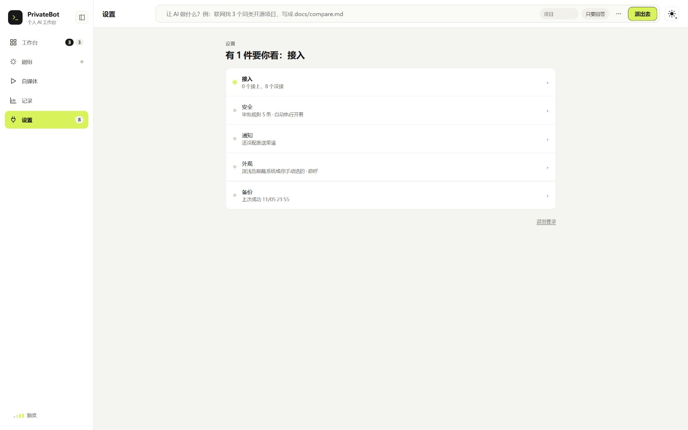 | 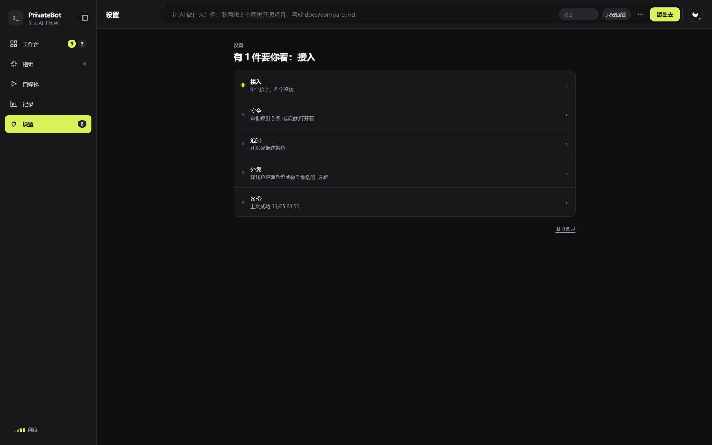 |

| 一层 | 是什么 |
|---|---|
| **工作台** | 一句话告诉你现在要不要管；四行：等你拍板 / 在跑 / 排队 / 做完。点一个任务，详情从右边滑出 |
| **剧组** | 每个 AI 一行：手上的活、擅长什么（五个点）、账号槽和额度 |
| **自媒体** | 七个平台（B站、小红书、抖音、视频号、X、Instagram、Facebook）各一行：粉丝、这周发了几条、多少播放；点开是每条内容的数据曲线 |
| **记录** | 每天谁做完了什么、一次过还是返工、额度花在哪 |
| **设置** | 接入、安全（审批规则、总开关）、通知、外观、备份；要填的东西点开才出现 |

额度在侧栏左下角：一排小点，点开看每个账号还剩多少。

**装好之后怎么用**：日常操作看 [`docs/USAGE.md`](docs/USAGE.md)，接第二个仓库看 [`docs/NEW-PROJECT.md`](docs/NEW-PROJECT.md)，让 agent 替你装看 [`docs/AGENT-INSTALL.md`](docs/AGENT-INSTALL.md)。

---

## 先说清楚：现在的边界

能用，我自己每天在用；但下面这些是真的，装之前请知道：

- **单人单令牌**。工作台只有一个账号，拿到你的登录就能批一切、看一切。只装给自己用，别几个人共用一个。
- **沙箱只覆盖一部分执行者**。只有「Claude Code + API Key」的执行者能进沙箱（§4.1）。WorkBuddy、DeepSeek Harness、用订阅登录的账号直接在你电脑上跑，挡它们的是钩子审批和命令检查——命令检查堵不完所有写法，这类执行者只派你信得过的活。
- **GitHub 任务通道先别开给别人的仓库**。Issue 正文现在会进提示词，别人写的话 AI 会读到（修复排在路线图里）。只接你自己写 Issue 的仓库。
- **主要在 Windows（家庭版）+ Docker Desktop 上验过**；macOS / Linux 的测试全套能过，但真机用得少。
- **自媒体的数据要手动填**；发布永远你自己点。
- 出了问题先 `npm run diagnose`，再开 Issue。

## 5 分钟跑起来

只想先看看它长什么样，四步就够，别的一概不用管。

1. **装 Node ≥ 22.18**（或者 Docker）。`node -v` 能打印出版本就行。
2. **拿代码，跑一次安装脚本**：

   ```bash
   git clone <这个仓库> ai-workbench && cd ai-workbench
   npm run setup          # 一问一答：生成两把钥匙、选项目、验证 key
   ```

   让 agent 替你装：把这一页交给它，它按 [`docs/AGENT-INSTALL.md`](docs/AGENT-INSTALL.md) 走，全程不用问你第二遍。

   不想用脚本、自己填也行（下面这段就是脚本做的事）：


   ```bash
   cp .env.example .env
   echo "WB_TOKEN=$(openssl rand -hex 24)" >> .env        # 脚本用
   echo "WB_PASSWORD=$(openssl rand -hex 12)" >> .env     # 网页登录用，必须和上面不一样
   ```

   没装 `openssl`（Windows 上常见）就自己敲两串随机字符，别用短密码。

3. **启动**，两种挑一种：

   ```bash
   docker compose up -d --build   # 有 Docker，推荐
   npm start                      # 没有 Docker，直接用 Node（会自己读 .env）
   ```

4. **打开 `http://localhost:3200`**，用 `WB_PASSWORD` 登录，点「新建任务」建一个，看它出现在看板上、审批躺在收件箱里等你点。

想让 AI 自动干活、接 GitHub、接手机，再往下看 §0 起的各节，都是可选的。

## 执行架构：谁在哪台机器上跑什么

常被问到的几件事先摆在这里。**只有「工作台」是必须的**，其余按需加。

```
浏览器 / 手机
   │ HTTP
   ▼
工作台（网页 + 审批 + SQLite 一个文件）      ← 数据全在这儿
   │ 领任务、回结果
   ▼
执行器 runner.mjs（宿主机，不进 Docker）
   │ 无头调用
   ▼
Claude Code CLI
   │ git（在 worktree 里改，你批了才推）
   ▼
你的仓库

旁路，都可选：反代 CLIProxyAPI（Docker）、Hook claude-hook.mjs（你的电脑）
```

| 组件 | 跑在哪 | 必须吗 | 不开会怎样 |
|---|---|---|---|
| 工作台（网页、数据库、审批） | 本机 Docker，或者 `npm start` 直接跑 | **必须** | 什么都没有 |
| 执行器 `scripts/runner.mjs` | **宿主机，不进 Docker**（要调本机的 Claude Code 和 git） | 想让它自动干活才要 | 点了「开始」任务一直排队 |
| Claude Code | 宿主机，执行器后台无头调用，你不用打开它 | 同上 | 同上 |
| 反代 CLIProxyAPI | Docker（可选） | 不必需 | 用不了「把订阅额度当接口」 |
| Hook `claude-hook.mjs` | 你自己电脑的 `~/.claude` | 不必需 | 手动开的会话不进看板 |
| GitHub | 云端，凭 token 访问 | 不必需 | 派活通道不可用；本机有 git 仓库照样能建任务 |

几条容易搞错的：

- **Docker 不是必须的**，它只是省事。没 Docker 就 `npm start`，数据同样是一个 SQLite 文件。
- **执行器一定跑在宿主机上**，不进容器：它要起本机的 `claude` 命令、在本机 git 里开 worktree。不把它开着，「开始」只等于排队。
- **执行器不需要 Claude 账号**，只要一个 Anthropic 兼容接口（DeepSeek、百炼都行），见 §4。
- **GitHub 不是必须的，连现成的仓库都不用有**：安装时不指定项目，会自动建一个空的 `~/ai-projects/first` 当第一个项目；以后在网页上「＋ 新建项目」再加。合并只在本地做，不需要远程；只有「推送」这一步需要仓库有远程（GitHub、Gitee、自建都行；没有远端的项目推送直接跳过，不算失败）。只有「决策端开 Issue 派活」才需要 `GITHUB_TOKEN`。

## 帮别人装

两种方式：

1. **让他自己的 coding agent 装**（推荐）：让他把仓库地址和 [`docs/AGENT-INSTALL.md`](docs/AGENT-INSTALL.md) 交给自己电脑上的 Claude Code / Codex / WorkBuddy，照着做；装完浏览器打开 `http://localhost:3200`。
2. **你坐在他电脑旁边装**：照「5 分钟跑起来」走一遍 → 配执行器（§4，用**他自己的**模型账号和密钥）→ 需要沙箱再开 §4.1 → 跟他一起跑通一个真任务。

规矩：**他的密钥只放在他的电脑上，你不经手、不保存**；号池只能是他自己的账号自己用。工作台本身不保存任何模型密钥。

收费帮公司或客户装、或者在公司里用，属于商用，先看 §11。

## 0. 先准备这些凭据

只填你实际要用的，其余留空。**所有 key 都只写在 `.env` 或你自己的配置文件里，永远不要提交进仓库。**

| 凭据 | 干什么用 | 去哪拿 | 填在哪 |
|---|---|---|---|
| `WB_TOKEN` | 脚本、curl、执行器调用接口 | 自己生成：`openssl rand -hex 24` | `.env` |
| `WB_PASSWORD` | 浏览器登录（≥ 12 位） | 自己想一个 | `.env` |
| `githubToken` | Issue 通道、日报 | GitHub → Settings → Developer settings → Fine-grained tokens：**只勾需要的仓库**，权限给 Issues: Read and write、Contents: Read-only，有效期建议 90 天 | 执行器配置 `~/.ai-workbench-runner.json` |
| `GITHUB_ALLOWED_AUTHORS` | 只认谁的 Issue | 填你自己的 GitHub 用户名 | `.env` |
| 模型 key（DeepSeek / 百炼 / 智谱） | 执行器干活、余额查询 | 各家控制台 | 执行器配置或 `.env`，**不进仓库** |
| `CPA_MANAGEMENT_KEY` | 读反代用量（可选） | CLIProxyAPI 的 `secret-key` | `.env` |

**为什么令牌和密码必须分开**：`WB_TOKEN` 是给脚本用的，它**做不了**批审批、改规则、改设置、导出整库这些事——这些都是「只有人能做」的动作。网页登录走 `WB_PASSWORD`，换一个服务端随机会话 Cookie，脚本令牌推算不出这个 Cookie。这样一个令牌泄露，坏人也没法替你批准一条 `rm -rf`。

> `GITHUB_ALLOWED_AUTHORS` **默认是空的，空的意思是谁都不收**。想让 Issue 通道工作就必须显式填上自己的用户名——否则任何人开个 Issue 就能往你电脑上派活。

## 1. 部署（Docker）

```bash
git clone <这个仓库> /opt/ai-workbench && cd /opt/ai-workbench
cp .env.example .env
echo "WB_TOKEN=$(openssl rand -hex 24)" >> .env     # 给脚本用：curl、执行器、心跳
echo "WB_PASSWORD=自己设一个十二位以上" >> .env     # 给网页登录用，和上面必须不一样
docker compose up -d --build
```

打开 `http://localhost:3200`，用 `WB_PASSWORD` 登录。

**两把钥匙别混**：令牌（`WB_TOKEN`）给脚本，密码（`WB_PASSWORD`）给人。网页登录换到的是一枚服务端随机会话 Cookie，令牌推不出来；批审批、改规则、改设置、导出整库这些动作只有网页上的会话能做，脚本令牌做不了。两个值填成一样的话，服务会拒绝启动并告诉你原因。

装完、或者重启机器之后，跑一次自检，九项一次看完：

```bash
npm run postboot                # 立刻查
npm run postboot -- --wait 120  # 开机后马上跑，最多等两分钟让引擎和容器起来
```

它只读，不改任何东西：Docker 引擎、两个容器的状态与重启策略、工作台健康、账号与余额、反代能列出模型、反代里的登录账号还在、容器之间网络通、备份是 48 小时内的。全部通过退出码 0，有问题退出码 1 并指明哪几项——可以直接挂进计划任务。

想先看看填满数据的样子：

```bash
docker compose exec workbench node --disable-warning=ExperimentalWarning scripts/seed.ts
```

（只在空库上执行；会写入演示任务、审批、用量。之后想清空，删掉数据卷 `docker compose down -v` 重来。）

**拉不到基础镜像**（`node:22-slim` 报 401 / 超时）：先 `docker logout` 再试；还不行就在 `.env` 里加一行 `NODE_IMAGE=<能访问的镜像源>/library/node:22-slim`，例如 `docker.m.daocloud.io/library/node:22-slim`。

**升级**：`git pull && docker compose up -d --build`。数据库迁移在启动时自动执行。

**不用 Docker**：装 Node ≥ 22.18，`WB_TOKEN=... npm start`。这样跑**默认也只绑本机**（`127.0.0.1`），局域网打不开；要让同一 Wi-Fi 的手机访问，设 `HOST=0.0.0.0`（局域网是明文，别在共用网络里这样开），出门仍走 Tailscale。

**Windows**：见 [docs/INSTALL-WINDOWS.md](docs/INSTALL-WINDOWS.md)，可以整段交给 coding agent 执行（包括 Docker Hub 连不上时的处理和开机自启）。

### 谁能打开它：只推荐两种方式

默认只绑本机（`127.0.0.1`）——装完只有这台电脑能打开 `http://localhost:3200`。想用手机，只有两种推荐方式，其余一律不建议：

| 场景 | 怎么做 | 代价 |
|---|---|---|
| **在家**（同一个 Wi-Fi） | `.env` 里写 `WB_BIND=0.0.0.0`，重建容器，手机打开 `http://电脑的局域网IP:3200` | 局域网里是**明文 HTTP**，密码和 Cookie 在网络上没加密。**别在公司、咖啡店、酒店这类共用网络上这样开** |
| **出门**（外网） | 电脑和手机装同一个 Tailscale，电脑上 `tailscale serve 3200`，手机打开它给的 `https://电脑名.xxx.ts.net` | 要装 Tailscale；地址只有你自己 tailnet 里的设备能开 |

**不要做**：在路由器上给 3200 做端口转发、用内网穿透（frp / ngrok 之类）、用 `tailscale funnel`、或者挂 Cloudflare Tunnel 直接对外——这些都会把这个页面变成公网可访问，等于把「能批准任意命令」的入口交出去。真要自己搭反向代理，必须带 HTTPS，并自己确认来源限制。

（024 起工作台会检测「看起来是从公网来的访问」：默认在页面顶部提醒你、一天记一条审计并推一次消息；设置 › 安全里可以改成直接拒绝，或者用 `WB_ALLOWED_HOSTS` 放行自己的域名。那只是**发现误用**的兜底，不是防护。）

## 2. 接入 Claude Code（审批 + 自动建任务）

在**运行 Claude Code 的电脑**上：

1. 把 `scripts/claude-hook.mjs` 放到 `~/ai-workbench/scripts/`（或者直接 clone 这个仓库到 `~/ai-workbench`）。
2. 写 `~/.ai-workbench.json`：
   ```json
   { "url": "http://<服务器IP>:3200", "token": "<WB_TOKEN>" }
   ```
3. 把 hooks 合并进 `~/.claude/settings.json`。工作台「设置 › 接入」页面有带好地址的版本可以直接复制：
   ```json
   {
     "hooks": {
       "PreToolUse": [{ "matcher": "Bash|Edit|Write|MultiEdit", "hooks": [{ "type": "command", "command": "node ~/ai-workbench/scripts/claude-hook.mjs", "timeout": 1800 }] }],
       "UserPromptSubmit": [{ "hooks": [{ "type": "command", "command": "node ~/ai-workbench/scripts/claude-hook.mjs", "timeout": 15 }] }],
       "Stop": [{ "hooks": [{ "type": "command", "command": "node ~/ai-workbench/scripts/claude-hook.mjs", "timeout": 15 }] }],
       "SessionEnd": [{ "hooks": [{ "type": "command", "command": "node ~/ai-workbench/scripts/claude-hook.mjs", "timeout": 15 }] }]
     }
   }
   ```
4. 重开 Claude Code。

审批结果怎么回到 Claude：

| 你在工作台点 | Claude Code 收到 |
|---|---|
| 批准 | `allow`：命令直接执行 |
| 驳回 | `deny` + 你的意见：Claude 不会重试同样的操作 |
| 打回修改 | `deny` + 你写的修改意见：Claude 按意见调整后再来 |
| 我来接管 | `deny`：Claude 停下来总结进度；任务转到你的待办 |
| 25 分钟没人处理 | `ask`：退回终端里原本的确认提示 |

工作台连不上时 hook 什么都不做，Claude Code 照常走自己的权限确认，不会卡住。

规则在「设置 › 审批规则」里增删和开关：`Bash` 匹配命令文本，`Edit`/`Write` 匹配文件路径，正则不区分大小写，同时命中多条时取风险最高的。

> 想让「反代池」里跑的 Claude Code 实例也接入？同样配置，在 `~/.ai-workbench.json` 里加 `"executor": "pool"`，它的任务就会归到反代池下面。

## 3. 同步 Token 用量

在跑 Claude Code / Codex 的电脑上定时执行。它读 `~/.claude/projects` 和 `~/.codex/sessions` 下的本地会话日志，**只上报 token 数、模型、项目目录名和时间**，不传对话内容。

```bash
node ~/ai-workbench/scripts/sync-usage.mjs           # 增量；--full 全量重扫（重复的会被忽略）
crontab -e
*/10 * * * * /usr/local/bin/node ~/ai-workbench/scripts/sync-usage.mjs >> ~/.ai-workbench-sync.log 2>&1
```

想让用量对上「账号与额度」里的账号，在 `~/.ai-workbench.json` 里加：

```json
{ "accounts": { "claude": "Claude Max · 主号", "codex": "Codex · Plus" } }
```

Codex 的日志格式没有官方文档，解析是尽力而为；格式变了只会少算，不会出错。

## 4. 让执行器自动干活（可选）

`scripts/runner.mjs` 是一台「干活的机器」：从看板领一个你点了开始的任务 → 给它在独立 worktree 里开分支 → 用 Claude Code 无头模式跑 → 干完回来等你批准合并和推送。

**不需要 Claude 账号。** 它只要求一个 Anthropic 兼容接口，所以可以直接接：

- DeepSeek 官方：`https://api.deepseek.com/anthropic`
- 阿里云百炼：`https://dashscope.aliyuncs.com/apps/anthropic`（模型名如 `deepseek-v4.1-flash`）
- 任何实现了 `/v1/messages` 的服务

配置写在 `~/.ai-workbench-runner.json`（不进仓库），完整样例见 [docs/runner.example.json](docs/runner.example.json)：

```json
{
  "workbench": "http://localhost:3200",
  "token": "与 .env 里的 WB_TOKEN 相同",
  "projects": { "my-repo": "C:/work/my-repo" },
  "worktreeRoot": "C:/work/wb-worktrees",
  "executors": {
    "pool": {
      "tool": "claude",
      "args": ["-p", "--output-format", "stream-json", "--verbose"],
      "backends": [
        { "name": "bailian", "model": "deepseek-v4.1-flash",
          "env": { "ANTHROPIC_BASE_URL": "https://dashscope.aliyuncs.com/apps/anthropic", "ANTHROPIC_AUTH_TOKEN": "<百炼 key>" } },
        { "name": "deepseek", "model": "deepseek-chat",
          "env": { "ANTHROPIC_BASE_URL": "https://api.deepseek.com/anthropic", "ANTHROPIC_AUTH_TOKEN": "<DeepSeek key>" } }
      ]
    }
  }
}
```

`backends` 按顺序排：派单建议指向哪个就走哪个，前一个报 401 / 403 / 429 / 额度不足时，**同一个任务自动换下一个重跑**（测试失败、语法错误这类不换——那会把真 bug 藏起来）。不写 `backends` 就退回单后端写法，直接写 `model` 和 `env`。

跑起来：

```bash
node scripts/runner.mjs --check   # 先自检：工具在不在、每个后端有没有模型名
node scripts/runner-guard.mjs     # 开始守在看板前面（守卫保证同时只有一个）
```

几道闸：

- 单任务默认 45 分钟（`maxMinutes`），超时杀掉。
- 用量超过**单任务 token 上限**（默认 2000 万，按执行者在「剧组」页可改）或超出时长上限，会停下来问你「继续还是终止」，不会闷头烧钱。
- 合并、推送各要一次审批（默认等 120 / 30 分钟）。
- 只在你自己的 worktree 里动文件；仓库里带 `.claude/settings*.json` 的会被**直接拒绝**，因为项目级配置能绕过门禁。
- 只领你点了「开始」的任务。

### 4.1 沙箱（可选，推荐）

不开沙箱时，执行器直接在你电脑上跑 AI，靠钩子审批和命令检查挡危险操作——但命令检查天生堵不完（字符串拼接、脚本里再起进程都绕得过）。开了沙箱，墙从「命令长什么样」换成「它在哪儿跑」：

- 每个任务一个一次性容器：不是 root、没有任何特权、根目录只读、**不挂你电脑上的任何目录**、没有 `docker.sock`；
- 网络没有出口，只能经白名单代理访问 npm、PyPI 这类包仓库；连不到你电脑上的工作台、反代池、局域网；
- 模型接口走「模型网关」容器：AI 手里只有假 key，真 key 经 stdin 写进网关的内存盘，不上命令行、不进环境变量；
- 代码以 bundle 进去、以补丁出来；补丁先过检查（不许碰 `.git`、符号链接、子模块、密钥文件……），过了才套到你的 worktree，之后的合并 / 推送审批照旧；
- 进不去沙箱就**直接失败**，不会悄悄退回你电脑上跑。

```bash
npm run sandbox:build      # 打镜像，要联网一次；Debian 源报错加 --apt-mirror mirrors.tuna.tsinghua.edu.cn
node --test test/sandbox0462-docker.test.ts   # 在你的电脑上跑一遍真容器探针
```

执行器配置里加 `"sandbox": "docker"`，可以写在全局，也可以写在某个执行者里；执行者自己写的优先。第一版只支持 Claude Code + API Key 后端（反代池、DeepSeek、百炼这类），所以推荐**只给这类执行者开**：

```json
"executors": {
  "pool": { "sandbox": "docker", "tool": "claude", "backends": [ … ] },
  "workbuddy": { "tool": "codebuddy" }
}
```

全局开了的话，WorkBuddy、DeepSeek Harness、用订阅登录（账号槽）的执行者要写 `"sandbox": "none"`，不然它们的任务会直接失败——进不去沙箱不会悄悄退回宿主上跑。宿主开了 Clash 一类代理的 fake-ip，再加 `"sandboxFakeIp": true`。设计和逃逸清单见 [docs/specs/046-sandbox.md](docs/specs/046-sandbox.md)。

**沙箱挡不住的**（写明白，别装作挡住了）：容器 / 内核本身的漏洞；白名单里的站点本身就是出口。

## 5. 机器心跳

在要看的机器上每分钟上报 CPU、内存、磁盘、GPU（`nvidia-smi`）、运行中的容器数：

```bash
crontab -e
* * * * * WB_URL=http://127.0.0.1:3200 WB_TOKEN=<令牌> WB_MACHINE=my-pc bash /opt/ai-workbench/scripts/heartbeat.sh
```

超过 3 分钟没心跳会显示离线。

## 6. 接入别的工具（Codex、脚本、n8n …）

任何能发 HTTP 的东西都能用。请求头带 `Authorization: Bearer <WB_TOKEN>`。

```bash
WB=http://<服务器IP>:3200; AUTH="Authorization: Bearer $WB_TOKEN"

# 建任务（executor: claude | codex | pool | local | me）
curl -s -X POST $WB/api/tasks -H "$AUTH" -H 'Content-Type: application/json' \
  -d '{"title":"迁移监控面板","executor":"codex","project":"demo-server","category":"ops","session_url":"https://chatgpt.com/codex/tasks/…"}'

# 更新进度
curl -s -X PATCH $WB/api/tasks/12 -H "$AUTH" -H 'Content-Type: application/json' -d '{"status":"running","progress":40,"step":"改配置"}'

# 发起审批，然后轮询结果（status: pending → approved / rejected / changes / takeover）
curl -s -X POST $WB/api/approvals -H "$AUTH" -H 'Content-Type: application/json' \
  -d '{"title":"发布 v0.3.2","summary":"docker compose up -d","risk":"high","executor":"pool","task_id":12}'
curl -s $WB/api/approvals/7 -H "$AUTH"

# 更新账号额度
curl -s -X PUT "$WB/api/accounts/反代%20A" -H "$AUTH" -H 'Content-Type: application/json' -d '{"executor":"pool","window_pct":88,"reset_note":"32m","status":"near"}'
```

完整接口：

| 方法 | 路径 | 说明 |
|---|---|---|
| GET | `/api/health` | 健康检查（无需令牌） |
| GET / POST | `/api/tasks` | 列表（`?status=running,review&executor=claude&category=dev`）/ 新建 |
| GET / PATCH / DELETE | `/api/tasks/:id` | 详情（含审批和动态）/ 更新 / 删除 |
| GET / POST | `/api/approvals` | 列表（`?status=pending`）/ 发起 |
| GET | `/api/approvals/:id` | 查询审批状态 |
| POST | `/api/approvals/:id/decide` | `{"decision":"approved\|rejected\|changes\|takeover","feedback":"…"}` |
| POST | `/api/approvals/:id/expire` | 关闭无人处理的审批 |
| POST | `/api/hooks/claude` | Claude Code hook 接收端（`claude-hook.mjs` 在用） |
| POST | `/api/usage` | `{"records":[{source_key, ts, executor, account, model, project, input_tokens, output_tokens, cache_tokens}]}` |
| GET | `/api/stats?days=7\|14\|30` | 汇总统计 |
| GET / PUT / DELETE | `/api/accounts[/:name]` | 账号与额度 |
| GET / POST / DELETE | `/api/machines[/:name/heartbeat]` | 机器心跳 |
| GET / POST / PATCH / DELETE | `/api/rules[/:id]` | 审批规则 |
| GET | `/api/events`、`/api/events.csv` | 审计日志 |
| GET | `/api/backup` | 下载数据库快照 |
| GET / POST | `/api/backup/state`、`/api/backup/run` | 自动备份状态 / 立刻备份一次（只能在网页上点） |

## 6.1 自媒体

「自媒体」页记你在七个平台发的每条内容和它的数据（播放、点赞、评论、转发、收藏、涨粉），只追加快照，曲线从快照画。

- **发布永远你自己点**。工作台不自动登录、不替你发。
- **数据先手动填**：国内平台基本没有给个人创作者的数据接口；爬虫和第三方数据服务一律不用（违反平台规则，会连累账号）。Instagram / Facebook 的官方接口以后接。
- 内容的打分、预测、复盘可以交给执行器里的技能做（比如 [cheat-on-content](https://github.com/XBuilderLAB/cheat-on-content)），工作台只派活、收结果、记数据。

## 7. 备份与恢复

- **自动**：每天 03:30（`WB_TZ`）把快照写到 `WB_BACKUP_DIR`，文件名 `<项目>_<日期>_<时间>_<版本>.db`，旁边一份同名 `.json` 记着时间、版本、迁移序号和数量，保留最近 30 份。设成网盘的同步文件夹就有了异地副本。
- 备份里**删掉了 `sessions`**：备份泄露也不能拿去登录，恢复后重新登录一次即可。key 和令牌本来就不在数据库里（在 `.env`）。
- **手动**：网页「设置 › 自动备份」点「立即备份」（只有网页上的登录能点，Bearer 令牌不行）；或 `curl -H "Authorization: Bearer $WB_TOKEN" $WB/api/backup -o workbench.db` 直接下载一份。运行中导出也是一致的快照。
- 超过 3 天没备份成功会给你建一条待办。
- 恢复：`docker compose down`，把备份拷进数据卷替换 `/data/workbench.db`（顺手删掉 `-wal` / `-shm`），再 `up -d`。完整步骤见 `docs/INSTALL-WINDOWS.md`。

`WB_BACKUP_DIR` 就是个普通文件夹，指到哪个网盘的同步目录都行：

| 网盘 | 填什么 |
|---|---|
| OneDrive | `C:/Users/你/OneDrive/wb-backups` |
| 坚果云 | `C:/Users/你/Nutstore Files/wb-backups` |
| Google 云端硬盘 | `C:/Users/你/Drive/wb-backups`——用 Drive 电脑版的「添加文件夹」同步，**不要**指向 `G:` 虚拟盘，Docker 写不进去 |
| iCloud（Windows） | `C:/Users/你/iCloudDrive/wb-backups` |
| 局域网 NAS | `//nas/share/wb-backups`（先确认 Docker 能访问这个共享） |

用正斜杠写最稳，路径里有中文和空格也可以。

## 8. 安全

- **两把钥匙，各管一头**：`WB_PASSWORD`（≥ 12 位）只用于网页登录，换到的是服务端随机生成的 HttpOnly 会话 Cookie；`WB_TOKEN` 只给脚本用 Bearer 令牌。批审批、改规则、改设置、导出整库这些动作**只有网页会话能做**，脚本令牌做不了，所以令牌泄露了也批不了一条 `rm -rf`。两个值相同会拒绝启动。
- 默认设计给**局域网**用。要从外网访问，请放在带 HTTPS 的反向代理后面（Caddy / Nginx / Tailscale），代理需传 `X-Forwarded-Proto`。
- 跨站写请求会被拒绝（检查 Origin + SameSite Cookie）；页面里的所有用户内容都经过转义；CSP 禁止外部脚本。
- 换钥匙：改 `.env` 里的 `WB_TOKEN` 或 `WB_PASSWORD` 后重启。换令牌要同步改脚本里的值；**换密码会让所有浏览器退出登录**（重启时发现密码变了就清掉全部会话，并记一条 `auth.password_changed` 审计）。所以怀疑密码泄露时，正确顺序是**先改密码再重启**——只改不重启，旧会话还活着。第一次在这台机器上启动时只记住指纹、不踢人。

## 9. 怎么分工维护它

这个仓库本身就是这样开发的：

- **决策端**（Claude，或任何能读仓库、能跑命令的模型）：写需求单、做界面和安全核心、审别人的提交；
- **本机的 coding agent**（比如 Codex）：实现、真机验收、在你电脑上跑测试；
- **工作台自己的执行器**：边界清楚的小活（文档、小样式、加测试），顺便验证「工作台开发工作台」。

**交叉验证**：谁写的，就由另一方验——决策端写的安全代码由本机 agent 专门试着绕，本机 agent 写的由决策端复核。自己审自己等于没审。

新接手的模型第一句话先读 [docs/specs/DECISION-HANDOFF.md](docs/specs/DECISION-HANDOFF.md) 和 [docs/specs/README.md](docs/specs/README.md) 的状态表。要用 GitHub Issue 派活，它用的账号得写进 `.env` 的 `GITHUB_ALLOWED_AUTHORS`（默认空，谁都不收）。

## 10. 开发

```bash
npm run dev       # 关闭鉴权、用 ./data/dev.db、改代码自动重启
npm run seed      # 往空库写演示数据（WB_DB 指定库文件）
npm test          # 端到端测试：真实 HTTP + 内存数据库 + 真实 hook / 同步脚本
```

代码结构和约定见 [CLAUDE.md](CLAUDE.md)（给接手维护的人和 coding agent 看）。
需求单与决策记录见 [docs/specs/README.md](docs/specs/README.md)。

## 11. 许可证

**PolyForm Noncommercial License 1.0.0**，全文见 [LICENSE](LICENSE)。说人话：**源码公开、只许非商用**。它不是 MIT 那种「随便怎么用都行」的开源许可证，严格说也不算 OSI 意义上的「开源」。

| | 可以吗 |
|---|---|
| 自己部署自己用、学习研究、业余项目、个人作品 | 可以 |
| 改代码给自己用；把改过或没改的代码分享给别人 | 可以，但要把许可证（或它的网址）和 `Required Notice` 那一行一起给对方 |
| 学校、公益组织、政府机构内部用 | 可以 |
| 免费帮朋友装在他自己电脑上、他自己非商用 | 可以 |
| 在公司、工作室、团队里当工作工具用（哪怕不收费、只在内部） | **不可以**，要商业授权 |
| 卖它、拿它做收费服务、收费帮客户部署或代运营 | **不可以**，要商业授权 |
| 放进收费产品、付费课程、付费社群 | **不可以**，要商业授权 |

**商业授权**：联系 **mashangfei@protonmail.com**，说明用在哪、几个人用、要不要改代码。

**第三方的东西不在这个许可证里。** 仓库里不包含任何第三方 Skill。README 里提到的工具各有各的许可证，用之前自己看：例如 cheat-on-content（MIT）、chat-to-content（Apache-2.0）；dontbesilent 的 dbskill **不允许再分发、不允许打包进产品**——帮别人装时只能让他从官方仓库自己装。

软件按原样提供，不担保；出了事自己担着。贡献规则见 [CONTRIBUTING.md](CONTRIBUTING.md)。

<details><summary>English summary</summary>

Source-available under the PolyForm Noncommercial License 1.0.0. Personal, hobby, research, educational and non-profit use is allowed, including sharing (keep the license and the `Required Notice` line). Any commercial use — inside a company, as a paid service, or bundled into a paid product — needs a commercial license: mashangfei@protonmail.com. Third-party skills mentioned in this README are not included and carry their own licenses.
</details>

## 路线图（还没做）

- **挂件**（056）：别的项目以「一句话 / 提醒 / 看板」接进工作台，项目本身不用改
- **三道审批**（047）：规则直接过 / 模型陪审 / 人批；先只陪审、记吻合率
- **多调度**（051）：一个任务拆给几个 AI；AI 派给 AI 有层数上限
- **统一 API 入口**（050）：你自己的多个账号背后一个兼容接口
- 订阅登录的账号进沙箱；沙箱第二档（真虚拟机）
- 多用户和权限

需求单和状态表见 [docs/specs/README.md](docs/specs/README.md)。
