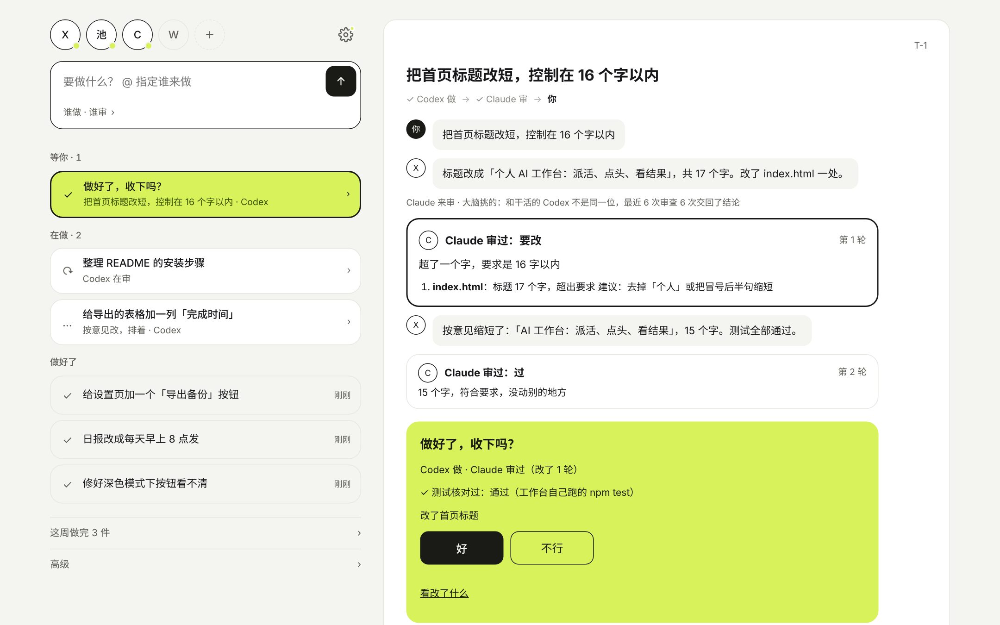

# 使用手册

装好之后每天怎么用、每个开关在哪、出问题怎么办。

- 还没装？看 `README.md` 的「5 分钟跑起来」，或者把 `docs/AGENT-INSTALL.md` 交给一个 agent。
- 想接第二个项目？看 `docs/NEW-PROJECT.md`。
- 当决策端的模型：看 `docs/specs/DECISION-HANDOFF.md`。



首页就是一条流：顶上一排执行者头像和一个输入框；下面是**等你**（要你点头或回话的）、**在做**、**做好了**。点一件事，它在右边打开（手机上盖上来）：谁说了什么、另一位怎么审的、要你点头的卡片。原来的任务看板、剧组、记录、自媒体页都还在，收在首页最下面的「高级」里，地址没变；设置在右上角齿轮。

---

## 1. 一天怎么用

```
打开首页
  ├─ 「等你」里有东西 → 点开，看它说了什么、审的那位怎么说、测试核对的结果 → 好 / 不行（写一句哪里不对）
  ├─ 「在做」 → 不用管；想看进度就点开
  └─ 派新活 → 输入框写一句话，回车（想指定谁做写 @名字，或点开「谁做 · 谁审」）
                     │
               执行者干完
                     │
         有人审？── 是 → 另一位只读地看一遍：过 / 要改（打回重做，最多两轮）/ 拿不准
                     │
           到你这里：「做好了，收下吗？」→ 好 → 合并到 main
                     │
           有远端的项目 → 再问一次「要传到网上的仓库吗？」→ 好 → 推送
```

**一件事上你会看到的**
- 标题下一行接力链：`Codex 做 → Claude 审 → 你`，停在谁手里谁加深。
- 点头卡上：谁做、谁审、改了几轮；工作台自己把测试跑了一遍的结果（`✓ 测试核对过：通过`，或 `! 它说测试通过，工作台自己跑了一遍：没过`，没过时能展开看输出）。
- 没成的事给办法：再做一次 / 换人 / 算了。超时、断网这类会先自动重试一次。

**说做完却没产出文件的，算没成**——工作台不是问答器，要的是成果。
只改 `docs/`（不含 `docs/specs/`）的改动，审过了、测试没挂，可以按设置自动收下；推送和部署永远要你点。

不想每天开网页：打开日报（设置 › 接入 › 日报），每天早上 08:00 会把概况写到一个固定 Issue。

---

## 2. 新建任务

最常用的是首页输入框：写一句话、回车。默认派给上次用的项目，执行者按规则（或大脑）挑；想指定就写 `@名字`，或点开「谁做 · 谁审」点选。要填更多字段时用「高级 › 任务看板」里的完整表单：

| 字段 | 什么意思 | 怎么填 |
|---|---|---|
| 标题 | 一句话说清要干什么 | 「给 RSS 抓取加去重与重试」比「优化一下」有用得多 |
| 说明（可选） | 背景、验收标准、别碰什么 | 写清楚「做完是什么样」，agent 才知道什么时候停 |
| 执行者 | 谁来干 | 选「我」= 进你的待办，不占用 AI；选某个执行者 = 进队列等执行器 |
| 分类 | 开发 / 文档 / 内容 / 运维 / 个人等 | 网页选中文标签即可；用 API 或配置填 `dev` / `docs` / `content` / `ops` / `personal` 这些 key，分类限制留空表示不限 |
| 项目 | 仓库的短名，要和执行器配置里的名字一致 | 留空也能建，但执行器认不出该在哪个目录干活 |
| 会话链接（可选） | 想留一条 Claude Code 会话链接 | 只显示，不会去打开 |

**什么时候选「我自己做」**：需要登录、需要当面判断、需要动钱、涉及别人账号的事，别派给 AI。选「我」之后它会出现在工作台「等你拍板」的待办里（也在剧组页「我」那个区），做完勾掉就行。

### 新建项目（含克隆）

任务页的「＋ 新建项目」不用你开终端：记一条请求，执行器在本机做——在 `projectsRoot`（执行器配置里那个「新项目放哪」的文件夹）下建一个子文件夹、`git init -b main`、写 `.gitignore` 和 `CLAUDE.md`、提交一次，再登记进 `projects`。也可以填一个 https 地址克隆已有仓库（第一版只收默认分支是 `main` 的）。

- 只能建在 `projectsRoot` 的**直接子目录**里，名字只能是小写字母、数字、`-`、`_`。目录里已经有人放了一个指到外面的链接会直接拒绝。
- **只克隆你信得过的仓库**：仓库自带的 `CLAUDE.md` 以后会被 agent 当规则读，等于你替它担保了那份说明。
- 工作台不碰 GitHub 令牌；私有仓库能不能克隆，取决于本机 git 自己的凭据（`gh auth login` 或凭据管理器）。

### 阶段和状态不是一回事

阶段是**推出来的**（不占字段），看任务卡片上那个小标签和详情顶部那条进度条：

| 阶段 | 意思 |
|---|---|
| 收件 · 待分派 | 刚从 Issue 或 hook 进来，还没定谁做 |
| 排队 | 等执行器来领。执行器没开会一直停在这 |
| 运行中 | 执行器正在干。超过单任务时长两倍没动静会标「可能卡住了」 |
| 等你批准 | 停下来等你批一个动作（不是合并、也不是推送） |
| 等你批准（合并） | 干完了，等你批合并 |
| 已合并 | 合并进 main 了，等你批推送 |
| 等你批准（推送） | 等你批推送到远端 |
| 已推送 / 完成 | 收工 |
| 失败 | 没干成，或者你手动标的 |

状态（`inbox / queued / running / asking / review / done / failed`）是存在库里的那一个；asking 是执行到一半等你回答问题。阶段是给人看的说法，**同一个状态可能对应不同阶段**（比如 done 还可能是「已合并」）。

---

## 3. 审批怎么批

对应：**工作台 › 等你拍板**。挂在任务上的审批只列一行和 `›`，点进右侧详情才批准；别在列表里找批准按钮。

一条审批就是「agent 想做一个动作，停下来问你」。卡片上有风险档：

| 风险 | 什么时候出现 | 建议 |
|---|---|---|
| 低 | 读文件、列目录、跑测试 | 看一眼就批 |
| 中 | 改文件、装依赖、合并分支 | 看清改了哪几个文件、测试过没过 |
| 高 | 删东西、推远端、动 `.env`、部署 | 一定自己看一遍改动 |

四个按钮各自会发生什么：

| 按钮 | 结果 |
|---|---|
| **批准** | 这次动作放行。合并和推送分开；只读无改动、文档自动放行和没有远端等情况，不一定都要批两次 |
| **不行，让它改…** | 任务回到执行器重做。**必须写意见**，意见会原样发给 agent，写成它能执行的：「先把测试补上再推」 |
| **驳回** | 这次不做，任务记为失败。适合「方向就错了」 |
| **我自己来** | 剩下的你自己做，任务进你的待办，不算失败 |

**为什么合并和推送各要批一次**：合并改的是你本地的 main，推送是把它发到远端、别人能看见。两件事的影响不一样，所以分开批。

**批错了怎么办**：如果这条任务已经**失败**（详情里有「重试合并」），点它重来。如果任务显示「已合并」、按钮不在了，说明合并已经落进本地 main，只能自己在仓库里 `git revert` 或 `git reset`，工作台不会自动撤销；已经推到远端的同理，工作台不替你做。

---

## 4. 规则怎么配

对应：**设置 › 安全 › 管理规则**。

规则回答一个问题：**agent 想做某个动作时，要不要停下来问我、按什么风险问。** 表格每行就是一条规则：最左边一个勾选框（勾着 = 生效，取消就临时停用），右边依次是规则名、工具、内容匹配、风险，最后一列「删除」。

加新规则时，点表下面折叠的「新增规则」展开表单，填完点「添加」：

| 表单字段 | 写法 | 例子 |
|---|---|---|
| 规则名 | 随便起，给自己看 | 拦推送 |
| 工具（正则） | 正则，匹配工具名；默认填好 `Bash` | `Bash`、`Edit\|Write`、`.*` |
| 内容匹配（正则，留空 = 任意） | 正则，匹配命令或路径 | `git push`、`rm -rf`、`\.env$` |
| 风险 | 低 / 中 / 高 | 高 |

**多条命中取最高风险**，不会因为有一条低风险就放过去。

五个常用例子：

| 想干什么 | 工具名 | 输入匹配 | 风险 |
|---|---|---|---|
| 拦推送 | `Bash` | `git push` | 高 |
| 拦删除 | `Bash` | `rm -rf\|del /s\|Remove-Item` | 高 |
| 拦改 `.env` | `Edit\|Write\|MultiEdit` | `\.env` | 高 |
| 将只读命令标为低风险（不等于自动放行） | `Bash` | `^(ls\|cat\|rg\|git status)` | 低 |
| 拦部署 | `Bash` | `docker compose up\|deploy\|kubectl apply` | 高 |

怎么测一条规则：新建一条，用「任务」建一个只读小任务，在执行器里让它跑一条会命中的命令，看审批有没有停在工作台。别拿正式任务试。

**规则跟称呼无关**：它只认工具名（`Bash`、`Edit`、`Write` 这类）和命令内容，不看页面上把这些叫什么，所以改称呼（设置 › 外观）不会影响任何已有规则，也不用跟着改。

---

## 5. 执行者与剧组

对应：**剧组**，点一个执行者展开账号槽、额度、手上的活和管理项。名称可以在外观里自定义，下面说的仍是同一个对象。

一个执行者就是「一个能干活的东西」：Claude Code + 某个后端、或者你自己。

每个执行者能调的东西：

| 设置 | 什么意思 |
|---|---|
| 优先级 | 派单建议按它排序，数字小的先推荐 |
| 单任务最长（分钟） | 两层意思：超过这个时间执行器不等了；超过它的 **2 倍**还没动静，卡片上会标「可能卡住了」 |
| 允许的分类 | 只领这些分类的任务，逗号分隔，写 `dev,docs` 这种 key；留空=都领 |
| 每日 token 上限 | 超过就不**再领新任务**，第二天重置；已经在跑的不会中途停（中途停是单任务预算的事） |
| 同时跑几个 | `1` 就是串行；调大要确认机器扛得住 |
| 自动执行 | 允许=新任务不用点「开始」就自己动（会花钱的执行者建议设成「不自动，手动点」） |
| 能不能被领取 | 「只派单，不在这里跑」= 完全不接活，只留个名字给派单建议用 |

**安全与总开关**（设置 › 安全 顶部）：暂停自动开始的新任务；你手动点开始的任务照常跑，已经在跑的也不受影响。**恢复只能在网页上点**，脚本令牌做不了——这是故意的。

自定义称呼：设置 › 外观，可以整体套用「剧组」预设，也可以一项项改。改的只是显示名，数据和审计里永远是内部 key。

### 让大脑替你选执行者（可选，默认关）

设置 › 安全 › **调度大脑** 打开之后，新建任务的执行者下拉第一项会多出「让大脑选」。

选它，任务先落在「我」名下、停在收件箱；执行器空闲时会问一次模型，模型在**合格名单**里挑一个，
给个难度（1–5）和一句理由，工作台再校验一遍才写进去。

| 谁说了算 | 管什么 |
|---|---|
| 规则（先筛） | 合格名单：已启用、能被领取、分类对得上、窗口 < 90%、余额高于提醒线、只读执行者不接要改文件的活、自动执行没暂停 |
| 大脑（会错） | 只在名单里挑一个，判难度、写理由（≤60 字）。错了就退回规则，并记一条审计 |

- **模型**：默认用执行器配置里那条代金券后端（`model` 以 `bl-` 开头）。要换就在
  `~/.ai-workbench-runner.json` 里加 `"brain": { "baseUrl": "…", "token": "…", "model": "…" }`。
  密钥只在执行器那台机器上，工作台不存、不传。
- **花多少**：每个任务最多问一次，输入不超过约 4000 字；每天最多 50 次（设置里能改），
  用完当天一律按规则派，工作台会提示一句。这些 token 记在数据 › 用量里，但**不算进任何执行者的额度**。
- **改得动**：任务卡和详情上写着「大脑：派给谁 · 难度 3/5 · 理由…」。派完还没开跑之前，
  你照样可以在「编辑任务」里改执行者；一改，这条就不再算大脑派的（`route` 清空，审计留一条）。
- **准不准**：剧组页每个执行者的「按谁派的」那一行，把大脑派的和手选的成绩分开算。
  少于 5 单只写单数，不给百分比——两个数算出来的比率是噪音。

关掉开关：表单里不再出现「让大脑选」，`/api/route/pending` 返回空。还在等派的任务会留在收件箱
（不会自己找人），点进去改个执行者就照常跑；其余一切照旧。

### 添加账号槽

一个执行者可以挂多个登录账号，轮流用：一个到上限就换下一个。选谁先用是这么排的——先花 14 天内
到期的（按到期早晚），再看优先级（数字小的先），再看窗口用得少的。

只有 **Claude** 和 **WorkBuddy（codebuddy）** 能加槽：它们的身份就是一个配置目录，一个目录就是一个
登录态。**dsh** 用 API 密钥标识身份，**反代池**的账号轮换在 CLIProxyAPI 那边，这两格是灰的，不是坏了。

四件事，按顺序做：

**1. 建目录。** 建在执行器那台机器上、执行器配置的 `slotsRoot` 下，默认 `~/.workbench-slots/<目录名>`。
目录名只用小写字母、数字和横线（`claude-b` 这种），别带路径。

**2. 在里面登录。** Claude Code，PowerShell 这么起：

```powershell
$env:CLAUDE_CONFIG_DIR="$HOME\.workbench-slots\claude-b"; claude
```

进去照常登录那个账号，登完退出。codebuddy 一样，把变量换成 `CODEBUDDY_CONFIG_DIR`。这一步只能在
你自己机器上做——工作台帮不了，也不该帮。

**3. 回来登记。** 剧组页 › 那个执行者 › 账号槽，填名字（`claude-b`）、目录名（`claude-b`）、标签、
到期日（可不填）。填过就到列表里，能看到状态（可用 / 在等 15:45 重置 / 已到期 / 停用）。
不想用了点「停用」，执行器就不再选它。

**4. 工作台只记目录名。** 没有令牌、没有 cookie、没有任何凭据进数据库。登录态只在你自己机器上那个
目录里；工作台记的只是「有这么个目录、它叫什么、什么时候到期」。

---

## 6. 额度与数据

对应：**设置 › 接入**（每个来源一张卡片）、**剧组**里展开执行者，以及**记录**下的更多用量明细。

| 来源 | 怎么接 | 能看到什么 |
|---|---|---|
| DeepSeek 官方 | `.env` 填 `DEEPSEEK_API_KEY`，重启 | 余额；低于提醒线会给你建一条待办 |
| 阿里云百炼 | 填 key，模型单价在「剧组 › 账号」里按控制台价目录（支持闲时半价） | 按用量估的余额，代金券也行 |
| CLIProxyAPI | `.env` 填 `CPA_URL` + `CPA_MANAGEMENT_KEY` | 账号、窗口额度、用量 |
| GitHub | 执行器配置填 `githubToken`，工作台配置填 `GITHUB_REPOS` / `GITHUB_ALLOWED_AUTHORS` | Issue 通道；日报 |
| WorkBuddy / AutoClaw | 网页读取器（跑在登录了账号的电脑上），或手动录 | 积分 / 额度 |
| GLM Coding Plan | `ZAI_API_KEY`（暂时不接，接口留着） | 窗口额度 |

卡片上的状态只有四种：**已接入 / 待你操作 / 停用 / 不接**。「待你操作」说明缺凭据或上次拉取失败，点开有下一步。

余额、窗口额度、代金券分开看：**余额**是钱，**窗口**是订阅的 5 小时/周额度百分比，**代金券**是按单价估出来的剩余额度。数字来自哪一次拉取，卡片上写了时间。

低额度提醒：在「剧组 › 账号」里给账号设一个提醒线，低于它会建一条待办，不会重复建。

用量同步：在跑 Claude Code / Codex 的机器上定时跑 `scripts/sync-usage.mjs`（见 设置 › 接入 › 用量同步），只上报 token 数，不上传对话内容。

---

## 7. 执行器

对应：宿主机上的一个进程，不是网页里的东西。页面只显示它在不在线。

真正调用 Claude Code、codebuddy 或 dsh 的是执行器；工作台自己不动手。工具有没有装好、登录和权限够不够，要在执行器那台机器上查。

怎么开：

```bash
node scripts/runner-guard.mjs    # 一直跑，窗口别关（守卫保证同时只有一个）
node scripts/runner.mjs --once   # 只领一个任务，调试用
node scripts/runner.mjs --check  # 只自检，不领任务
```

`--check` 会逐项告诉你：配置文件在哪、门禁配置对不对、项目路径在不在、编码工具找不找得到、每个后端有没有模型名和环境变量。**装完先跑这个**。

在线怎么判断：执行器每 30 秒心跳一次；90 秒没心跳就算离线。工作台顶部会写「执行器没开，点开始后任务会排队」，点「怎么开」查看启动方法。别只凭终端还开着判断它在线。

开机自启：Windows 见 [INSTALL-WINDOWS.md](INSTALL-WINDOWS.md) 的「让执行器（runner）也开机自启」，按那里安装，别自己拼一份计划任务命令。macOS/Linux 用 `launchd` 或 systemd user unit。这里不再抄一份写法。

`~/.ai-workbench-runner.json` 里的 `backends` 是**按顺序**试的：前一个报 401/403/429 或额度不足，同一个任务自动换下一个重跑一次，任务详情里会多一行「百炼 失败（…），已换到 DeepSeek 官方」。

执行器空闲时还会做一件小事：问一句工作台「有要大脑拿主意的任务吗」（042，开关关着时这一步直接返回空）。
问模型用的就是 `backends` 里那条代金券后端（`model` 以 `bl-` 开头），密钥不出这台机器。
想换模型就加一段 `"brain": { "baseUrl": "…", "token": "…", "model": "…" }`，别写进仓库。

常见报错：

| 报错 | 原因 | 怎么办 |
|---|---|---|
| `401` / `403` | key 错了、没开通、站别不对（国内站/国际站 key 不通用） | 换 key；确认 `ANTHROPIC_BASE_URL` 和 key 属于同一家 |
| `429` | 限流或额度用完 | 等一会儿；或把 `backends` 里另一个放前面 |
| `门禁自检失败` | 项目里有 `.claude/settings.json`，执行器怕它替 agent 改权限 | 删掉那个文件，或换一个仓库 |
| `worktree` 失败 | 项目不是 git 仓库 / 工作区有未提交改动 / `worktreeRoot` 没权限 | `git status` 看一眼；换个目录 |
| `被拒绝的项目` | 项目名不在配置的 `projects` 里 | 在配置里加一行，`: 名字=路径` |

---

## 8. GitHub 通道（可选）

对应：**设置 › 接入 › GitHub**。

把 fine-grained token 填在执行器的 `~/.ai-workbench-runner.json`（字段 `githubToken`，只授权需要的仓库，Issues 读写、Contents 只读）。工作台的 `.env` 保留 `GITHUB_REPOS`（`用户名/仓库名`）和 `GITHUB_ALLOWED_AUTHORS`（只认这些人的 Issue，**空=谁都不认**）。从旧版升级时，把原先工作台的 `GITHUB_TOKEN` 移到执行器配置，再重启两边。

Issue 怎么写：

```
标题：给 RSS 抓取加去重

项目: demo-feed
分类: dev
执行者: pool
---
背景……
验收：……
```

前三行是头（可以只写一部分），`---` 之后是任务说明。带 `wb-task` 标签的 Issue 会被拉成任务，状态是「排队」，**要你点「开始」才动**。

评论指令（只有白名单作者有效）：把 `/wb rework` 或 `/wb cancel` 单独写一行；返工意见写在下一行。执行器会把收件、开工、完成和推送结果评论回 Issue。

执行器空闲时每 5 分钟转发一次，离线时通道暂停。工作台无需访问 GitHub，也无需开公网入口或配置 webhook。

---

## 9. 日报（可选）

对应：**设置 › 接入 › 日报**。默认**关**。

打开后每天早上（默认 08:00，按 `WB_TZ`）往一个固定 Issue 写一条概况：昨天完成/失败几个、花了多少 token、等你处理几件（待审批/亲自做/卡住）、执行器在不在、哪个账号额度偏低、备份多久没做、接入里几项等你操作。

- 默认**不带任务标题**；打开标题开关后只列失败的、等审批的、卡住的，标题会打码。
- 不带命令、路径、日志、余额数字。
- **同一天只发一条**；电脑关机错过了，下次开机补一条，标「补发」。
- 日报由工作台排队、执行器发送；在接入页看到发送成功才算送达。日报评论不会变成任务。
- 发不出去时页面会写原因，不影响别的功能。

---

## 10. 备份与恢复

对应：**设置 › 备份**。

自动备份每天 03:30（按 `WB_TZ`）写一份，保留 30 份。放在哪儿取决于你怎么装的：

| 怎么装的 | 在 `.env` 里设 | 实际写到 |
|---|---|---|
| Docker | `WB_BACKUP_DIR=C:/Users/你/网盘/同步目录` | 这台电脑上的那个目录（容器里固定看成 `/backups`） |
| `npm start` 直接跑 | 同样设 `WB_BACKUP_DIR` | 就写这个目录；想另指一个也行，设 `WB_BACKUP_PATH` |

这个文件夹可以是网盘的同步目录，那样就自动有了异地副本。**备份页上没有改目录的输入框**，只有一个说明文字和「立即备份」「下载数据库备份」两个按钮——要换目录只能改 `.env` 再重启。

每份备份是**两个文件**：一个 `.db`（可以直接当数据库用的 SQLite 文件）和一个同名的 `.json`（记着时间、版本、各项数量，用文本编辑器能看）。备份里**删掉了登录会话**，所以恢复后要重新登录一次。

点「立即备份」可以马上跑一次；页面上有上次成功时间、累计份数、失败原因。

**演练一次恢复**（建议每季度做一次，别等真出事）：

1. 挑一份备份 `.db`，复制一份改名，例如 `restore-test.db`。**别动原件**。
2. 起一个临时实例指向这份拷贝：`PORT=3299 WB_DB=./data/restore-test.db WB_BACKUP_OFF=1 npm start`。
3. 打开 `http://localhost:3299`，用你现在的密码登录（备份里没有会话，但账号密码来自 `.env`），确认工作台的数字和任务、剧组页的账号都对。
4. 关掉临时实例，删掉 `data/restore-test.db`。

真出事要恢复时：停掉工作台 → 把选定的 `.db` 放回 `WB_DB` 指的位置（Docker 默认在 `workbench-data` 卷里）→ 启动 → 重新登录。

**注意**：临时实例别和正式实例共用备份目录，演练时一定带 `WB_BACKUP_OFF=1`，否则它会按自己的节奏也去备份一遍。

---

## 11. 手机访问与推送（可选）

**只有两种推荐方式**（024 起默认只绑本机，装完只有这台电脑能打开）：

- **在家、同一个 Wi-Fi**：`.env` 里加 `WB_BIND=0.0.0.0`，重建容器（`docker compose up -d`），手机打开 `http://电脑的局域网IP:3200`。局域网里是明文 HTTP，**公司、咖啡店、酒店这类共用网络别这样开**。
- **出门、外网**：手机和电脑装同一个 Tailscale，电脑上 `tailscale serve --bg 3200`，手机打开它给的 `https://电脑名.xxx.ts.net`。把那个地址填进「设置 › 通知 › 手机访问地址」，日报最后一行和通知里的链接就用它；没填就只推文字、不带链接。

  （实测：走这条 HTTPS 路径登录正常，Cookie 带 `Secure`，页面按钮的同源检查也正常，不需要额外开关。用完想关掉就 `tailscale serve reset`。）

**不要做**：`tailscale funnel`、路由器端口转发、内网穿透（frp / ngrok）、直接挂 Cloudflare Tunnel。工作台只要能批准任意命令，暴露到公网就等于把机器交出去。

设置 › 安全里能看到当前是不是「检测到公网访问」（024b），看到橙色提示就说明有人从公网地址打开了它。

推送（通知渠道）也在 **设置 › 通知**：先选类型（企业微信群机器人 / 飞书群机器人 / Bark（iOS）/ 通用 webhook），把地址粘进去点「添加」，旁边有「发送测试消息」。推送里只有标题和一句摘要，不带命令和日志。

---

## 12. 安全清单

- **两把钥匙**：`WB_TOKEN` 给脚本和 agent，`WB_PASSWORD` 给人和浏览器。两者必须不同，密码至少 12 位。
- 换密码要**先改 `.env` 再重启**：只改不重启，旧会话还活着。重启后所有浏览器会话会被清掉，要重新登录。
- **不在聊天里贴 key**。key 只放 `.env` 或 `~/.ai-workbench-runner.json`，两个都不进仓库。
- 不暴露公网（见上一节）。
- 定期换令牌：GitHub 的 fine-grained token 建议 90 天有效期；换了记得改 `.env` 再重启。
- 审批、改规则、改设置、导出整库**只能在网页上做**，脚本令牌做不了——所以令牌泄露不等于被人改配置。
- **怎么发现被人动过**：数据 › 审计，看 `auth.*`（登录失败、密码变更）、`rule.*`（规则改动）、`approval.*`（谁批的）、`digest.*`。每条都有时间、谁、做了什么。

---

## 13. 排查：现象 → 原因 → 怎么办

| 现象 | 原因 | 怎么办 |
|---|---|---|
| 打开 3200 打不开 | 工作台没起，或端口被占 | `docker compose ps` 看状态；端口被占就 `PORT=3201 npm start` |
| 登录页说「网页登录已关闭」 | `.env` 里没填 `WB_PASSWORD`，或少于 12 位，或和 `WB_TOKEN` 一样 | 改 `.env` 后**重启** |
| 登录说「密码不对」但自己觉得没错 | 改过密码没重启，或者用的是旧标签页的会话 | 重启工作台，重新登录 |
| 一直卡在登录页 | Cookie 被清 / 用了不同端口访问 | 换回同一个地址再登一次 |
| 任务一直「排队」 | 执行器没开 / 没点「开始」/ 执行者被暂停 | 三样逐个看：工作台顶部提示、任务详情、设置 › 安全 的总开关 |
| 页面说「执行器没开」但它明明在跑 | 心跳没到（连不上、容器网络不对）或超过 90 秒没心跳 | 看执行器窗口的日志；`curl` 一下 `/api/health` |
| 任务「可能卡住了」 | 执行器进程没了（关窗口、睡眠、被杀） | 详情里点「标记失败」，重开执行器 |
| 合并/推送一直等审批 | 审批只能人来点 | 去工作台点；脚本令牌批不了 |
| 打回修改后 agent 没动 | 意见写得太笼统，或者执行器没在跑 | 意见写成可执行的句子；确认执行器在线 |
| 测试在凌晨失败 | 备份、日报、额度拉取都在夜里跑，可能撞在一起 | 改 `WB_BACKUP_AT` 错开；看数据 › 审计里那段时间的记录 |
| 迁移后某个页面 500 | 数据库多了新列，旧进程还在跑 | 重启工作台；还不行就看容器日志里的第一条错误 |
| 推送被拒 | 远端有新提交 | 在任务详情里「重试推送」，它会先拉再推 |
| 备份目录写不进去 | 路径不存在、没权限、网盘没登录 | 改 `.env` 的 `WB_BACKUP_DIR` 指向一个本地已存在、能写的文件夹，然后重启（页面上的备份页只能看、不能改） |
| 备份占地方 | 每天一份、留 30 份，数据库越大越多 | 正常。想少占：把一个月的挪去网盘、或调 `WB_BACKUP_NAME` 换库单独留，但别删最近三份 |
| 日报没发出来 | 令牌没有 Issues 读写权限，或仓库名写错 | 设置 › 接入 › 日报 看错误原文；令牌重新授权 |
| 日报发了两条 | 手动点了一次又赶上自动 | 同一天只会自动发一条，手动不受限；不用管 |
| 额度数字一直不变 | 拉取失败（卡片是「待你操作」），或凭据过期 | 点卡片里的「立即重试」，看错误 |
| 执行器说找不到 `claude` | 没装 Claude Code，或 PATH 里没有 | 装好后**重开终端**再跑执行器 |
| `npm start` 报 `Bad option` | Node 太旧（要 ≥ 22.18） | 升级 Node |
| 改了称呼但页面有的地方还是旧名字 | 浏览器缓存 | 强制刷新（Ctrl/Cmd + Shift + R） |
| 手机打不开 | Tailscale 没连，或填的是 localhost | 用 `tailscale serve` 给的地址，别填 localhost |

## 自媒体怎么记

打开「自媒体」，点「＋ 记一条」，选平台、填标题和发布日期，链接可以留空。相同内容发到多个平台时，把「同一条内容的名字」填成相同的值。支持 B站、小红书、抖音、视频号、X、Instagram、Facebook。

点平台可记账号名和当前粉丝数。点内容的数据录入表单，填播放、点赞、评论、转发、收藏、涨粉，保存一次就是追加一份快照，后续快照用于画曲线。页面统计来自手动录入的数据。
